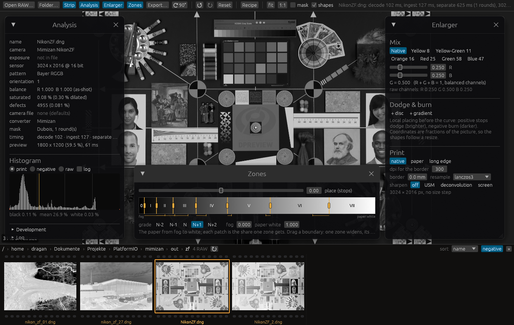
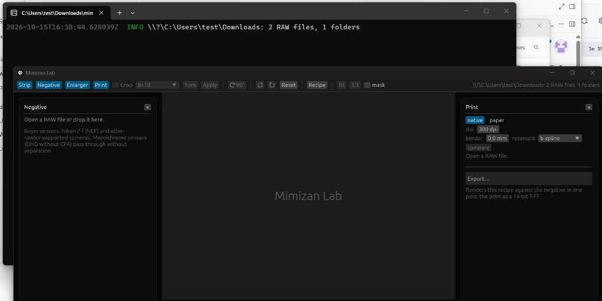

# Mimizan Lab

A darkroom for the digital negative.

You open a colour RAW. Mimizan Lab makes a monochrome negative from it and prints that negative the way a split-grade enlarger prints a sheet of paper: one placing, a soft exposure and a hard one.

It is for analog photographers and fine-art printers who decide the print on the paper.

The name is the beach at Mimizan, where the idea came up watching the surf: separate the waves, and keep the picture underneath. Lab is the darkroom.



## A session

The folder lies along the bottom as a strip of negatives. The picture in the middle is the print, paper-white border included, so a 20 mm border is judged as it will go on the wall.

*Enlarger* holds the mix and the only tone controls a sheet of paper has. *soft* is filter 00, *hard* is filter 5, both in stops of time from the base print. The zone bar is that paper from its black to its white. More soft light greys the highlights. Less hard light opens the shadows. A drag on the bar is one more or less second under the enlarger. The line under the sliders names the single grade this pair equals, and how many stops of the scene the paper holds.

*Crop* frames a darkroom ratio: 4×5, 5×7, 8×10, 11×14, 16×20, 20×24, or square. *Turn* stands that ratio portrait on a landscape negative. *Apply* makes the window the picture, in whole pixels.

*Print* sets the sheet, the dpi and the border, and writes one 16-bit TIFF. The recipe is saved next to the RAW and comes back when the file is opened. Leaving a changed recipe asks first.

## The negative

A colour sensor records luminance and chrominance in one mosaic. Mimizan Lab takes the luminance straight from that mosaic. The default path does not demosaic. There is no hidden tone curve. Every step is measured, and the same recipe gives the same bytes.

On photographs a lens can take, that negative leads when the picture is band-limited and sits in the leading group when a lens-like picture still reaches the sensor. With reconstruct it has the highest mean of those photographic tests. The tables, and the pixel-sharp test where it trails, are in the [detailed README](DETAILED.md#where-it-stands).

The print is a sheet of Ilford Multigrade. The soft pass is the measured grade-00 curve (ISO R 160). The hard pass is grade 5 (ISO R 50). The preview is that print.

## Get it

Prebuilt builds are on the [releases page](https://github.com/Draganito/mimizan/releases).

Debian and Ubuntu:

```bash
sudo apt install ./mimizan_0.10.11-1_amd64.deb
```

That installs the darkroom window, `mimizan-gui`, and the `mimizan` command.

Windows, 64-bit Intel and AMD: unzip `mimizan-0.10.11-x86_64-windows.zip` and start `mimizan-gui.exe`. Leave `cameras` and `look` next to the two programs. Building from source, the command line and the camera file are in the [detailed README](DETAILED.md#install).

Apple silicon: unzip `mimizan-<version>-aarch64-macos.zip` and start `mimizan-gui`. Leave `cameras` and `look` beside the two programs. The programs use the frameworks that come with macOS.



The same paper is on the phone: [Mimizan Lab for Android](https://github.com/Draganito/mimizan-lab-mobile).

Free software, GPL-3.0-or-later.

## Go further

- [Handbook](docs/HANDBOOK.md) — why the darkroom is built this way, in four chapters ([booklet](docs/handbook.pdf))
- [Detailed README](DETAILED.md) — the session in full, install, command line, and where the measurements stand
- [The method](docs/PAPER.md) — the signal, the formulas, the constants
- [The specification](docs/SPEC.md) — the contract
- [The measurements](docs/RESULTS.md) — every number, by the version that produced it
