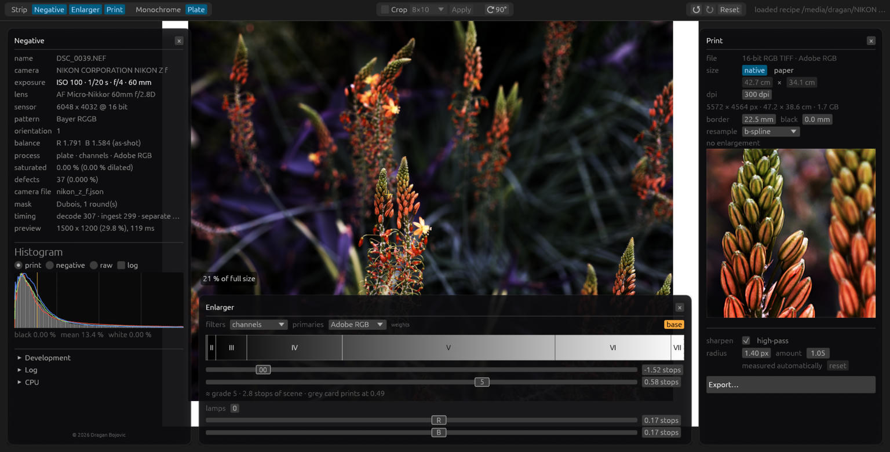

# Mimizan Lab

A darkroom for the digital negative.

You open a colour RAW. Mimizan Lab makes a monochrome negative from it and prints that negative the way a split-grade enlarger prints a sheet of paper: one placing, a soft exposure and a hard one.

Mimizan Lab also accepts a file from a monochrome sensor, for anyone who wants to develop it here. That sensor has no colour filter, so the file opens as the measurement.

It is for analog photographers and fine-art printers who decide the print on the paper.

> Lift the colour off. Print what remains.
>
> Pure monochrome. A new split-grade digital darkroom, authentic for fine-art monochrome. A minimal, honest darkroom. The Bayer file is read as frequencies: luminance below, colour on the carriers. No demosaicing. The pixels stay measured. Nothing is reconstructed unless you ask for it, and the character and soul of the lens are left unchanged. Focus on the picture, and on what you want to say with it. Your art.
>
> Dragan Bojovic

The name is the beach at Mimizan, where the idea came up watching the surf: separate the waves, and keep the picture underneath. Lab is the darkroom.



## The negative

> With Mimizan your digital negative is a negative again: every tone comes from the light, none from an algorithm guessing what might have been there. And that is exactly why, where your lenses really resolve, it draws finer than any demosaicer.

A colour sensor records one signal. The luminance sits in the low frequencies. The colour rides on carriers at the highest frequency the sensor can hold. [Alleysson, Süsstrunk and Hérault](https://doi.org/10.1109/TIP.2004.841200) described that signal. [Dubois](https://doi.org/10.1109/LSP.2005.859503) showed how to lift the colour off the carriers. Their papers reconstruct a colour picture. A monochrome photograph needs only what remains once the colour is gone.

A RAW converter invents a red, a green and a blue at every photosite, by interpolation and, in the methods that lead these comparisons, by a guess about the local edge. A later step adds the three and keeps one. The guesses stay in the grey: zippers, mazes, and a colour error that has become fine texture. On a large print that texture is the part that never belonged to the lens.

Mimizan Lab subtracts the colour and keeps the luminance. On this path a pixel is a sum of photosites the sensor measured. Detail the lens put on the mosaic stays detail.

Alleysson and Dubois were not quite enough for a photograph. The separation runs on white-balanced photosites, as the camera metered them, so a grey subject puts nothing on the carriers and those carriers can carry real detail. The colour is estimated in two directions, in the way Dubois estimates it, and the copy the luminance has leaked into is trusted less. Where both copies agree, the colour band is opened and the detail underneath comes back. The white balance before the separation, the use of both colour components, and that agreement test are the part built here.

Both stop there. Where the colour is strong, the two carrier copies alone cannot say which one the luminance has spoiled, so the separation also reads the direction of the structure from the part of the signal below the carriers, which is free of colour. That is still a choice between measured sums, never a computed value. One step further is a switch, off until you set it: where luminance and colour really overlap, those samples are computed, and the mask beside the negative records, pixel by pixel, how much was calculated. On the Kodak set at the band limit of a lens, that share is 5%. On the Nikon Z f files at the sharpness the camera recorded, it is 0.7%, and the step costs there. Where a lens-like picture still reaches the sensor, it is 12%.

### How the separation works

The Bayer mosaic is a modulated signal. Multiply a picture by the pattern of the colour filters and the luminance stays where it was, in the low frequencies, while the two colour differences are shifted to the corners of the spectrum: one to the diagonal carrier, the other to two copies, one at the horizontal limit and one at the vertical. The grey photograph is what sits below those carriers. Separating it means estimating the colour on the carriers and subtracting it, so that each pixel of the negative is a weighted sum of photosites the sensor measured, and nothing else.

The two copies of the second colour difference ought to be identical. They are not, because luminance leaks into them: fine vertical detail reaches the copy at the horizontal limit, fine horizontal detail reaches the other. Dubois measured the energy around each copy and trusted the one with less, since the leak adds energy. That works until the colour is strong. Then both copies carry a lot of energy, the weight falls back to one half, and the leak passes into the grey as texture that was never in the picture.

Since 0.12 the separation also reads the base band. Below the carriers the mosaic is free of colour, so the orientation of the structure can be measured there without the colour getting in the way: second differences along x and along y, squared and smoothed, give a structure tensor, and its anisotropy says whether the structure runs horizontally or vertically. That orientation tells which copy the luminance can have leaked into, and that copy is trusted less, even where the colour is strong. The decision is no longer a guess between two spoiled copies; it is measured on the part of the signal that cannot be spoiled.

A third measurement opens the colour band again. Where the two copies agree, their correlation is high, the colour there is real and the band can be opened, so the detail underneath, the last octave the lens delivered, comes back. In 0.12 the tensor also opens the band of the copy it has found clean. All of this is weights: energies, an orientation, a correlation, each of them measured on the file. No value is computed from a model of what an edge should look like. The same file and the same recipe give the same bytes, on any machine and any number of threads.

That is why the negative is finer where a lens really draws. A demosaicer invents two of the three colour values at every photosite and needs an assumption about the local edge to do it; the error of that assumption survives the sum to grey. The separation leaves the luminance intact up to the carriers and takes away only the colour. Detail a lens puts below the band limit of the sensor passes through untouched, which is where the 2.4 to 4.3 dB over RCD on the Z f files and the twenty-four of twenty-four at the band limit come from. Only where the detail is sharper than any lens delivers do luminance and colour truly overlap in the spectrum; there the switch above computes those samples and the mask records where.

The print is a measured sheet of Ilford Multigrade. Soft is grade 00, ISO R 160. Hard is grade 5, ISO R 50. There is no hidden tone curve. The preview is that paper, and the TIFF is that sheet. The same recipe gives the same bytes.

On the Kodak set, brought to the band limit of a photograph, the linear negative is 51.8 dB. The best of the sixteen demosaicers we ran, DCB in RawTherapee, is 49.1 dB; RCD is 48.9 dB. All twenty-four pictures are above every one of them: VNG, PPG, AHD, DCB, DHT and AAHD in libraw, and fast, VNG4, AHD, EAHD, HPHD, DCB, LMMSE, IGV, AMaZE and RCD in RawTherapee. With the switch set the mean is 52.4 dB and 5% of the pixels are computed. On four Nikon Z f files at the sharpness the camera recorded, the linear mean is 53.9 dB against 50.7 dB for RCD, and all four are above it by 2.4 to 4.3 dB; the switch costs 0.3 dB there. Where a lens-like picture still reaches the sensor, the linear mean is 51.6 dB and DCB is 51.5 dB; nine of the twenty-four lead every demosaicer. The switch puts that mean at 52.6 dB, with 12% computed, and twenty-three lead. On detail sharper than any lens delivers, LMMSE in RawTherapee leads the linear negative, 43.1 dB to 37.3 dB. The switch passes that Kodak test at 42.1 dB, with half the pixels computed, and still trails by a decibel. On the four Z f files made twice as sharp as the camera saw them, RCD leads by 0.5 to 1.9 dB, with the switch and without it. The means, and how many pictures lead, are in the paper.

It opens a Bayer RAW, and a file from a sensor with no colour filter. Not a RAW converter: no colour output, no noise reduction, no lens correction. On this branch the command has one exception, the three-colour plate of `docs/EXPERIMENTAL.md`: three separations through three filters, printed together, the way Prokudin-Gorsky made colour; still no demosaicing. X-Trans, Quad-Bayer, Foveon and Nikon HE/HE* are not supported.

## A session

Drop a RAW file or a folder on the window, or open one. The folder lies along the bottom as a strip of negatives. It closes when you click the picture and release, or drag the crosshair and release; B brings it back, and the arrow keys still change the file. Tab hides the three panels. Scroll zooms the print about the pointer; a double click switches between fitted and 1:1. Undo is Ctrl+Z, redo is Ctrl+Shift+Z or Ctrl+Y. Reset puts the controls back to their defaults and leaves the negative where it is.

The picture in the middle is the print. A white border is added around it, and a black edge can sit inside that white, never wider than it, so the sheet is judged as it will go on the wall. The crosshair marks the spot the 1:1 box in *Print* is reading.

*Negative* is the file and the development. The histogram reads the print, the linear negative, or the raw channels, on a linear or a log axis. White balance is as shot, gray world, none, or a manual red and blue. The mask is Dubois, adaptive, or off. *Reconstruct the last octave*, off by default, computes the samples where luminance and colour overlap; the mask beside the negative records where. *Repair defects* fills dead photosites. Apply recomputes the picture. A monochrome sensor has none of the colour controls: the file is the measurement.

*Enlarger* holds the mix and the only tone controls a sheet of paper has. The mix is Native, one quarter, one half, one quarter, or Panchromatic when a camera file is loaded, or a filter in front of that: yellow 8, yellow-green 11, orange 16, red 25, green 58, blue 47. R and B move the same mix by hand; G is what remains, and the three sum to one. *soft* is filter 00, *hard* is filter 5, both in stops of time from the base print, two stops either way. *base* returns there. The zone bar is that paper from its black to its white. More soft light greys the highlights. Less hard light opens the shadows. A drag on the bar is one more or less second under the enlarger, and moves both exposures together. The line under the sliders names the single grade this pair equals, and how many stops of the scene the paper holds.

*Crop* frames the picture. The list opens as a table: the picture's own ratio, read from its pixels, then each sheet both ways — 4×5 and 5×4, on through 20×24 — and a square across the row. The side that is framed is sunk. *Apply* makes that window the picture, in whole pixels. Enter does the same. 90° turns the picture itself.

*Print* sets the sheet and writes one 16-bit TIFF. Native keeps the negative's pixels and writes the dpi into the file. Paper fits the picture into a size in centimetres at that dpi; the black edge and the white border are added around it. Resample is B-spline by default, or area (each output pixel is the source area it covers: a mean when shrinking, the pixel held when enlarging), Mitchell, Catmull–Rom, or Lanczos. Peak is a high-pass sharpening of that print: the picture plus an amount of itself minus a Gaussian blur. The radius is that blur, in print pixels, measured on the negative and multiplied by the print's scale, including a reduction. The amount does not change. The box under it is those print pixels at 1:1; drag it, or drag the crosshair on the sheet. The recipe is saved next to the RAW and comes back when the file is opened. Leaving a changed recipe asks first.

## Get it

Prebuilt builds are on the [releases page](https://github.com/Draganito/mimizan/releases).

Debian and Ubuntu: [mimizan_0.12.0-1_amd64.deb](https://github.com/Draganito/mimizan/releases/download/v0.12.0/mimizan_0.12.0-1_amd64.deb). Install the downloaded file:

```bash
sudo apt install ./mimizan_0.12.0-1_amd64.deb
```

That installs the darkroom window, `mimizan-gui`, and the `mimizan` command.

Windows, 64-bit Intel and AMD: [mimizan-0.12.0-x86_64-windows.zip](https://github.com/Draganito/mimizan/releases/download/v0.12.0/mimizan-0.12.0-x86_64-windows.zip). Unzip it and start `mimizan-gui.exe`. Leave `cameras` and `look` next to the two programs. The programs carry the Visual C++ runtime, and the window opens without a terminal. An unsigned download asks SmartScreen for confirmation. The same program is on the [Microsoft Store](https://apps.microsoft.com/detail/9ph4p5qb18z5), signed.

Apple silicon: [mimizan-0.12.0-aarch64-macos.zip](https://github.com/Draganito/mimizan/releases/download/v0.12.0/mimizan-0.12.0-aarch64-macos.zip). Unzip it and open `Mimizan Lab.app`. The command line is `Mimizan Lab.app/Contents/MacOS/mimizan`. The programs use the frameworks that come with macOS. The first launch is a right-click and Open.

If macOS says the app is damaged and should be moved to the Trash, it is blocking the unsigned download. Open a terminal next to the unzipped app and run this to clear the quarantine flag and sign it locally:

```bash
xattr -cr "Mimizan Lab.app" && codesign --force --deep -s - "Mimizan Lab.app"
```

From source (a recent stable Rust, a C compiler for the small allocator mimalloc, and on Linux and macOS a working OpenGL for the window; Windows uses DirectX 12, which comes with the system):

```bash
git clone https://github.com/Draganito/mimizan
cd mimizan
cargo build --release
./target/release/mimizan-gui
```

The same paper is on the phone: [Mimizan Lab for Android](https://github.com/Draganito/mimizan-lab-mobile).

Free software, GPL-3.0-or-later.

## Privacy

Mimizan Lab runs on your computer. It does not send photographs, settings, or anything else anywhere.

## The command

The window is the darkroom. The command is there when the print is already decided.

```bash
mimizan info photo.nef
mimizan negative photo.nef -o photo_neg.tif
mimizan print photo_neg.tif -o photo_print.tif --size 30x40cm --paper 0,-0.5 --border-mm 20
```

`info` says what is in the file. `negative` writes a 16-bit linear TIFF, and a mask beside it. `print` writes the sheet: half a stop less hard light, a 20 mm paper-white border. The rest is `mimizan --help`.

## The method

The formulas and the constants are in [the paper](docs/PAPER.md). The note it started from is [the whitepaper](docs/whitepaper_v1.pdf).
