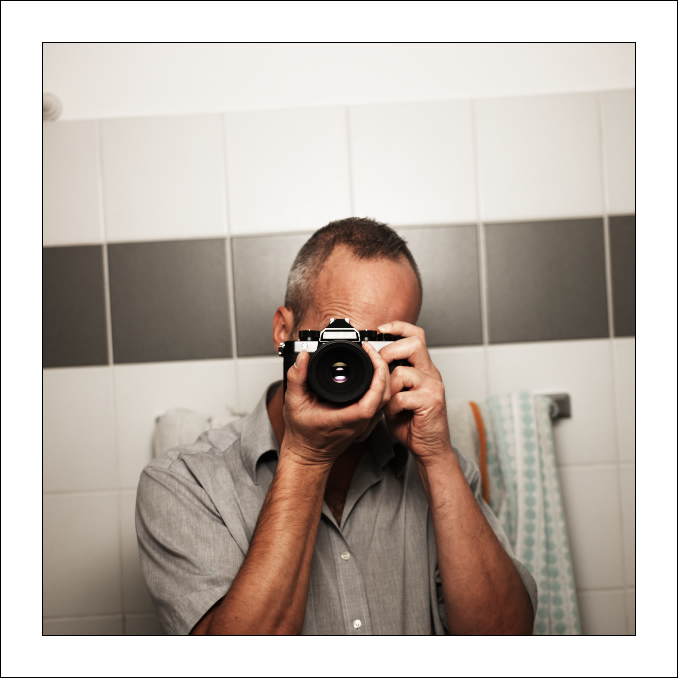
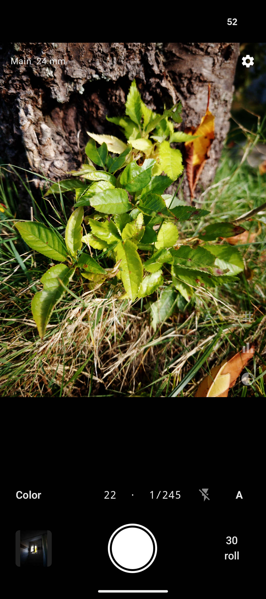
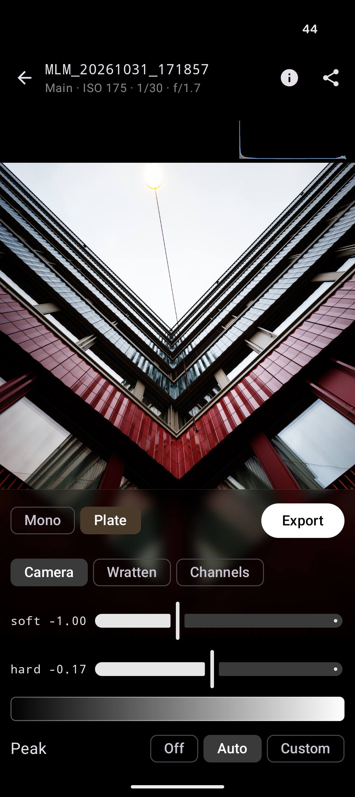

# Mimizan Lab — Handbook

A darkroom for the digital negative. You open a colour RAW. The program
makes a monochrome negative from it and prints that negative the way a
split-grade enlarger does: one soft light, one hard light. Or three
plates in colour, the same paper.

No account. No network. The pictures stay on your computer.

## Get it

**Computer**

- [Linux (Debian/Ubuntu)](https://github.com/Draganito/mimizan/releases/download/v0.16.6/mimizan_0.16.6-1_amd64.deb) — open the file, or `sudo apt install ./mimizan_0.16.6-1_amd64.deb`
- [Windows](https://github.com/Draganito/mimizan/releases/download/v0.16.6/mimizan-0.16.6-x86_64-windows.zip) — unzip it and start `mimizan-gui.exe`. Leave `cameras` and `look` next to the programs. Or the [Microsoft Store](https://apps.microsoft.com/detail/9ph4p5qb18z5).
- [Mac, Apple silicon](https://github.com/Draganito/mimizan/releases/download/v0.16.6/mimizan-0.16.6-aarch64-macos.zip) — open `Mimizan Lab.app` (first launch: right-click, Open). Or the Mac App Store / TestFlight.

**Phone**

- Android: install the [APK](https://github.com/Draganito/mimizan-lab-mobile/releases). It needs Android 13 and a camera that offers RAW.
- iPhone: TestFlight, the app *Mimizan Lab*.

## On the computer

Drop a RAW file or a folder on the window. Or open one. NEF, CR2, CR3,
ARW, DNG, RAF, and the usual Bayer formats.

Three panels around the picture.

**Negative** (left) is the file. Leave the white balance on *as shot*
most of the time. *Apply* develops again when you have changed something.

**Enlarger** (below) is the paper.

1. At the top, *Monochrome* or *Plate*.
2. In monochrome the filter row: Native, Pan, yellow, orange, red…
3. *soft* is the soft light (filter 00). It places the highlights.
4. *hard* is the hard light (filter 5). It places the shadows.
5. The grey strip under them moves both lights together, like one more
   second under the enlarger, or one less.

Zero on both sliders is about grade 2. *base* goes back there.

**Print** (right) is the sheet.

- The size is the sheet in the printer. Type one side, the other follows.
- The white border and the black film edge sit inside the sheet.
- *Export* writes a 16-bit TIFF, the same as the preview.

Crop: *Crop* at the top, pick a format (4×5, 5×7, square…), *Apply*.
90° turns the picture.

Scroll zooms. A double click switches between the whole picture and 1:1.
The recipe sits as a small file next to the RAW and comes back when you
open it again.

**Colour (Plate).** *Plate* at the top. Three plates, the same paper,
two lamps, red and blue, under the exposures. Green is the reference.
The taking filters are Camera, Wratten or Channels. The export is an
RGB TIFF, sRGB by default.

## On the phone

The same paper. The finder is different: on Android it is already the
print; on the iPhone it is the camera picture.

  
  

1. **The shutter.** A RAW lands on the roll. *JPEG* writes a picture at
   once. *Developer* opens the development. *Raw* only keeps the frame.
2. **Development.** *Mono* or *Plate*. The filters sit under them.
   *soft* and *hard* are the same two lights as on the computer.
   The strip under them is the zone: left is darker, right is lighter.
3. **Export** writes a JPEG, a TIFF, or the linear negative for the
   desktop.

A tap sets focus. Flash: Off / Auto / On. The roll at the bottom right
lists every frame. Delete it there, not in the gallery.

## In short

| You want | You do |
| --- | --- |
| Open a picture | Drop a RAW on the window |
| Lighter / darker | Drag the strip under *soft* and *hard* |
| More contrast | *hard* to the right, or *soft* to the left |
| Less contrast | the other way |
| Crop | *Crop* → format → *Apply* |
| Save | *Export* on the computer or on the phone |
| Colour | *Plate* |

Nothing else is in the program. No curve, no local mask, no account.
If the picture holds on this paper, it is a picture.
