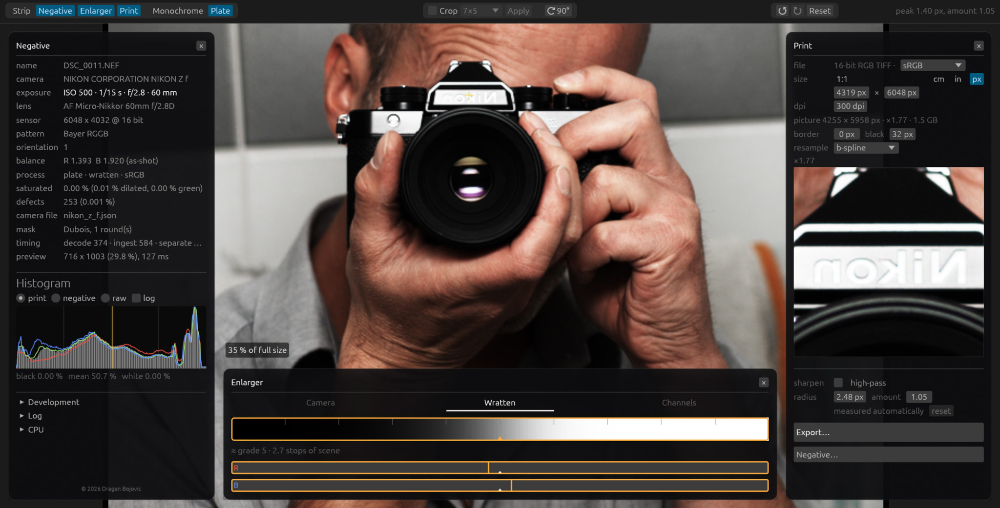

# Mimizan Lab — Handbook

A darkroom for the digital negative. You open a colour RAW. The program
makes a monochrome negative from it and prints that negative the way a
split-grade enlarger does: one soft light, one hard light. Or three
plates in colour, the same paper.

No account. No network. The pictures stay on your computer.

## Get it

**Computer**

- [Linux (Debian/Ubuntu)](https://github.com/Draganito/mimizan/releases/download/v0.18.5/mimizan_0.18.5-1_amd64.deb) — open the file, or `sudo apt install ./mimizan_0.18.5-1_amd64.deb`
- [Windows](https://github.com/Draganito/mimizan/releases/download/v0.18.5/mimizan-0.18.5-x86_64-windows.zip) — unzip it and start `mimizan-gui.exe`. Leave `cameras` and `look` next to the programs. Or the [Microsoft Store](https://apps.microsoft.com/detail/9ph4p5qb18z5).
- [Mac, Apple silicon](https://github.com/Draganito/mimizan/releases/download/v0.18.5/mimizan-0.18.5-aarch64-macos.zip) — unzip it. macOS blocks the unsigned download and says the app is damaged. Open a Terminal next to `Mimizan Lab.app` and run:

```bash
xattr -cr "Mimizan Lab.app" && codesign --force --deep -s - "Mimizan Lab.app"
```

Then open the app (right-click, Open). The Mac App Store and TestFlight builds are signed and do not need this.

**Phone**

- Android: install the [APK](https://github.com/Draganito/mimizan-lab-mobile/releases). It needs Android 13 and a camera that offers RAW.
- iPhone: TestFlight, the app *Mimizan Lab*.

## On the computer

Drop a RAW file or a folder on the window. Or open one. NEF, CR2, CR3,
ARW, DNG, RAF, and the usual Bayer formats.



Three panels around the picture.

**Negative** (left) is the file. Leave the white balance on *as shot*
most of the time. *Apply* develops again when you have changed something.
What you chose stays with this file, in its recipe; the next file opens
with its own.

**Enlarger** (below) is the paper.

1. At the top, *Monochrome* or *Plate*.
2. The filter row: Native, Pan, Y8, YG11, O16, R25, G58, B47. Click
   one, or draw the mouse along the row. In the plate: Camera, Wratten,
   Channels.
3. The paper strip under it: a grey wedge, printed as the paper stands.
   Drag it and both lights move together, like one more second under
   the enlarger, or one less.
4. The wheel over the strip is the grade. Up is harder, down is softer.
   The exposure stays.
5. Double click: the base print. Double click again: back where you were.

The line under the strip names the grade the pair equals. The pair
itself, *soft* (filter 00) and *hard* (filter 5) in stops, is in the
recipe file next to the RAW. Zero on both is about grade 2; the frame
is amber whenever you are away from it.

**Print** (right) is the sheet.

- The size is the sheet in the printer. Type one side, the other follows.
- The white border and the black film edge sit inside the sheet.
- *Export* writes the sheet, the same as the preview: a 16-bit TIFF, or
  an 8-bit JPEG for the screen. TIFF or JPEG on the file line; the
  program remembers it.
  A sheet of more than 4 GiB (a colour print past 715 megapixels) is
  written as a BigTIFF, which a classic TIFF cannot hold; not every
  older program opens one.

Crop: *Crop* at the top, pick a format (4×5, 5×7, square…), *Apply*.
Straighten: with *Crop* open, *Straighten*, then draw a line along
something that should be level or upright; the picture turns and the
frame shrinks to what fits. Or type the degrees; 0° undoes it. *Apply*
keeps both.
90° turns the picture.

Dodge and burn: *Burn* at the top. The brush is yours, not the
picture's: set it once, lock it, and paint every negative with it.
*Hand* is an ellipse with a soft edge, *Card* a straight edge with a
soft shadow. *Set* shows the tip in the middle of the picture, and
nothing in the picture changes while you shape it: the dots size it,
the ring turns it, the square is the penumbra, the number is the stops
(drag up and down, hundredths; Shift slows it), and the row beneath
it is the light, *both*, *soft* or *hard*; leave it on *both* unless
you want the split-grade burn. Enter or *Paint* locks it and keeps it.
Locked, the tip follows the pointer: drag the hand along the picture,
or push the card from where you press to where you let go (the side it
ends up on had the light all along). +1 is twice the time where the
pass went through (darker), −1 half (lighter); passing twice adds.
Alt shows the strokes; *Clear* at the top takes them away. Escape
opens the brush again, and a second Escape puts the tool down. Orange
burns, blue dodges.

Scroll zooms. A double click switches between the whole picture and 1:1.
The recipe sits as a small file next to the RAW and comes back when you
open it again.

**Colour (Plate).** *Plate* at the top. Three plates, the same paper,
two lamps, red and blue, as two bars under the strip, R and B at their
left edge, zero at the mark in the middle. Click or drag, wheel for a
twelfth, double click for zero and back. Green is the
reference. The taking filters are Camera, Wratten or Channels. The
export is an RGB TIFF or JPEG, sRGB by default; the primaries are in
*Print*, on the file line.

## On the phone

The same paper. The finder is different: on Android, and on an iPhone
with Apple Log (15 Pro and later Pro), it is already the print; on the
other iPhones and the iPad it is the camera picture, and there the
paper is set in the developer, on the picture: no grade and no strip
under a finder that would not answer, and a shot is *Developer* or
*Raw*. On the Pro iPhones the shutter takes about a second: the camera has to leave the log
stream for the RAW and come back, and the finder holds its last frame
meanwhile.

<p align="center">
  
  
</p>

1. **The shutter.** A RAW lands on the roll. *JPEG* writes a picture at
   once, where the finder is the paper. *Developer* opens the
   development. *Raw* only keeps the frame.
2. **Development.** *Mono* or *Color*, the phone's word for the plate.
   Under them the same two rows as on the computer: the filter row, and
   the paper strip. Drag the strip: lighter or darker. Pinch it: harder;
   spread it: softer. A double tap is the base print again, and a
   second one brings the pair back. Behind the strip sit the same
   *soft* and *hard* as on the computer; the print is the same.
3. **Export** writes a JPEG, a TIFF, or the linear negative for the
   desktop.

A tap sets focus and metering; hold to clear it. Flash: Off / Auto /
On. The roll at the bottom right lists every frame. Delete it there,
not in the gallery.

**Too dark?** Sand, snow and a bright window make every camera print
dark. Nothing is lost: the frame is on the roll, open it and drag the
strip to the right. That is the whole correction, and it is exact. Where
the finder is the paper (Android, the Pro iPhones with Apple Log) the
same strip sits under the finder: drag it before the shot and you see
the print you will get. It
stays where you leave it, and turns amber to say so; a double tap puts
it back, and the strip is white again.

## In short

| You want | You do |
| --- | --- |
| Open a picture | Drop a RAW on the window |
| Lighter / darker | Drag the paper strip |
| Back to the base print | Double-click the strip; on the phone, double-tap |
| The filter | Click it in the row over the strip; on the phone, tap it |
| Phone prints too dark | Open it from the roll, strip to the right |
| Darker or lighter before the shot (Android, Pro iPhone) | Drag the strip under the finder |
| More contrast | Wheel up over the strip; on the phone, pinch it |
| Less contrast | Wheel down; on the phone, spread it |
| Crop | *Crop* → format → *Apply* |
| Straighten a tilted horizon | *Crop* → *Straighten* → draw a line along it → *Apply* |
| Save | *Export* on the computer or on the phone |
| Colour | *Plate*; on the phone, *Color* |

Nothing else is in the program. No curve, no local mask, no account.
If the picture holds on this paper, it is a picture.
