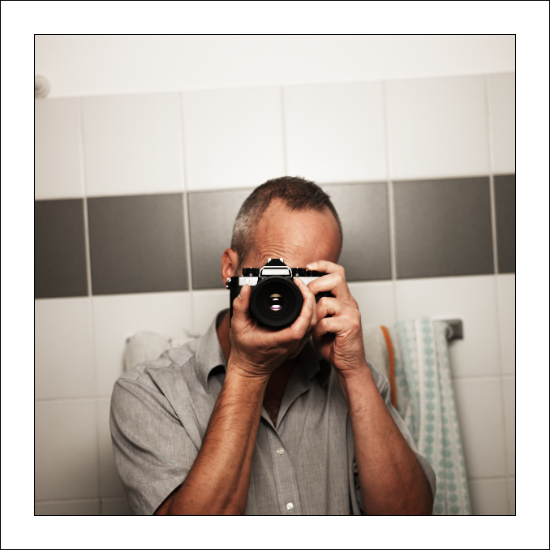
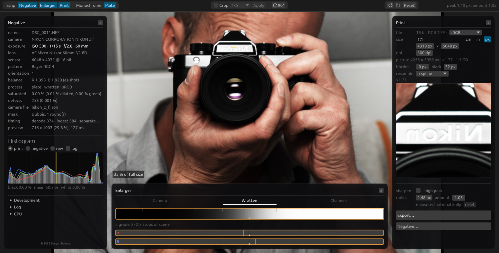
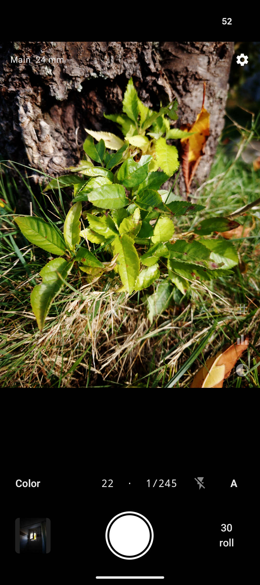
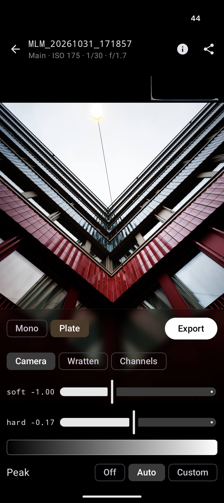

# Mimizan Lab — Handbuch

Eine Dunkelkammer für das digitale Negativ. Du öffnest ein Farb-RAW.
Das Programm macht daraus ein Schwarzweiss-Negativ und belichtet es
wie ein Splitgrade-Vergrösserer: ein weiches Licht, ein hartes Licht.
Oder drei Platten in Farbe, dasselbe Papier.

Kein Konto. Kein Netz. Die Bilder bleiben auf deinem Rechner.

## Das Programm holen

**Computer**

- [Linux (Debian/Ubuntu)](https://github.com/Draganito/mimizan/releases/download/v0.16.6/mimizan_0.16.6-1_amd64.deb) — Datei öffnen oder `sudo apt install ./mimizan_0.16.6-1_amd64.deb`
- [Windows](https://github.com/Draganito/mimizan/releases/download/v0.16.6/mimizan-0.16.6-x86_64-windows.zip) — Ordner entpacken, `mimizan-gui.exe` starten. `cameras` und `look` bleiben neben den Programmen. Oder der [Microsoft Store](https://apps.microsoft.com/detail/9ph4p5qb18z5).
- [Mac, Apple-Chip](https://github.com/Draganito/mimizan/releases/download/v0.16.6/mimizan-0.16.6-aarch64-macos.zip) — `Mimizan Lab.app` öffnen (beim ersten Mal Rechtsklick → Öffnen). Oder Mac App Store / TestFlight.

**Telefon**

- Android: [APK](https://github.com/Draganito/mimizan-lab-mobile/releases) installieren. Braucht Android 13 und eine Kamera mit RAW.
- iPhone: TestFlight, App *Mimizan Lab*.

## Am Computer

Zieh eine RAW-Datei oder einen Ordner auf das Fenster. Oder Datei öffnen.
Nef, Cr2, Cr3, Arw, Dng, Raf und die üblichen Bayer-Formate.

Drei Felder um das Bild.

**Negative** (links) ist die Datei. Weissabgleich meist *as shot* lassen.
*Apply* entwickelt neu, wenn du etwas geändert hast.

**Enlarger** (unten) ist das Papier.

1. Oben *Monochrome* oder *Plate*.
2. Bei Schwarzweiss die Filterreihe: Native, Pan, Gelb, Orange, Rot…
3. *soft* ist das weiche Licht (Filter 00). Es setzt die Lichter.
4. *hard* ist das harte Licht (Filter 5). Es setzt die Schatten.
5. Der graue Streifen darunter schiebt beide Lichter zusammen, wie eine
   Sekunde mehr oder weniger unter dem Vergrösserer.

Null auf beiden Reglern ist ungefähr Gradation 2. *base* geht dahin zurück.

**Print** (rechts) ist das Blatt.

- Die Grösse ist das Blatt im Drucker. Eine Seite tippen, die andere folgt.
- Weisser Rand und schwarzer Filmrand sitzen im Blatt.
- *Export* schreibt eine 16-bit-TIFF, genau so wie die Vorschau.

Zuschneiden: oben *Crop*, Format wählen (4×5, 5×7, quadratisch…), *Apply*.
90° dreht das Bild.

Scrollen zoomt. Doppelklick wechselt zwischen ganzes Bild und 1:1.
Das Rezept liegt als kleine Datei neben dem RAW und kommt beim nächsten
Öffnen zurück.

**Farbe (Plate).** Oben *Plate*. Drei Platten, dasselbe Papier, zwei Lampen
rot und blau unter den Belichtungen. Grün bleibt die Referenz. Die
Farbfilter oben sind Camera, Wratten oder Channels. Der Export ist eine
RGB-TIFF, Standard sRGB.

## Auf dem Telefon

Dasselbe Papier. Der Sucher ist anders: auf Android schon der Abzug,
auf dem iPhone das Kamerabild.

  
  

1. **Auslösen.** Ein RAW landet im Roll. *JPEG* schreibt gleich ein Bild.
   *Developer* öffnet die Entwicklung. *Raw* nur auf den Roll.
2. **Entwicklung.** *Mono* oder *Plate*. Darunter die Filter.
   *soft* und *hard* sind dieselben zwei Lichter wie am Computer.
   Der Streifen darunter ist die Zone: nach links dunkler, nach rechts heller.
3. **Export** schreibt JPEG, TIFF oder das lineare Negativ für den Desktop.

Tippen scharfstellt. Blitz: Aus / Auto / Ein. Der Roll unten rechts
zeigt jede Aufnahme. Löschen dort, nicht in der Galerie.

## Kurz

| Du willst | Du tust |
| --- | --- |
| Ein Bild öffnen | RAW auf das Fenster ziehen |
| Heller / dunkler | Den Streifen unter *soft* und *hard* schieben |
| Mehr Kontrast | *hard* nach rechts, oder *soft* nach links |
| Weniger Kontrast | umgekehrt |
| Zuschneiden | *Crop* → Format → *Apply* |
| Speichern | *Export* (Computer) oder *Export* (Telefon) |
| Farbe | *Plate* |

Mehr steht nicht drin. Keine Kurve, keine lokale Maske, kein Konto.
Wenn das Bild auf diesem Papier hält, ist es ein Bild.
